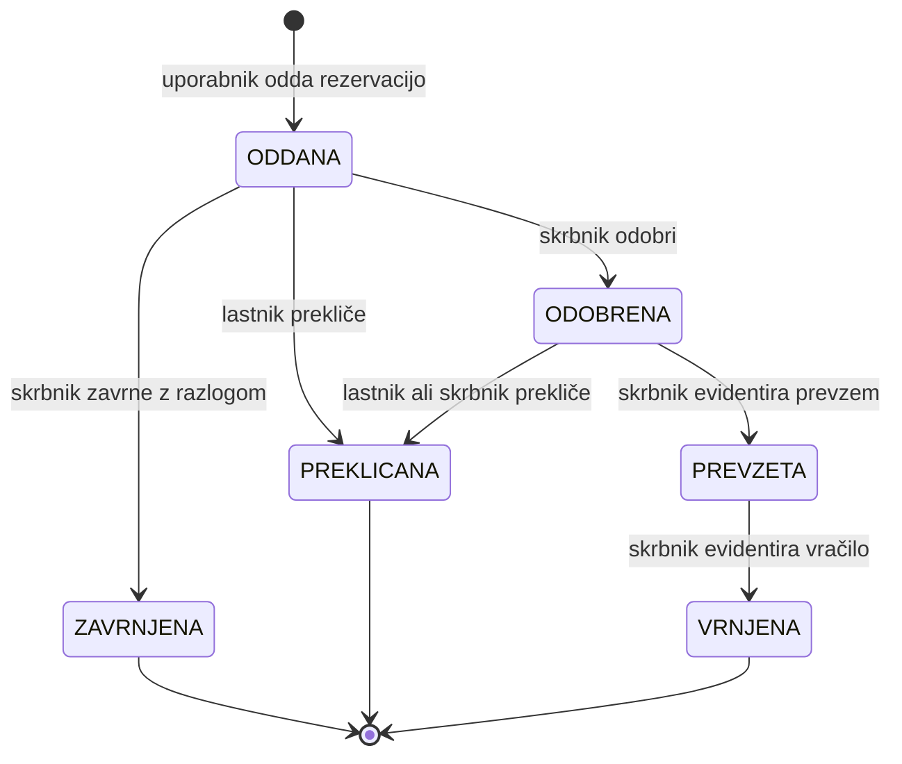

# 02 – Funkcionalnosti in obseg

## Pojmi

- **Kos opreme** – en fizičen predmet z inventarno oznako, npr. FOTO-02. Ima stanje `UPORABEN`, `V_POPRAVILU` ali `ODPISAN`.
- **Rezervacija** – zahteva enega uporabnika za en kos v enem terminu. Hrani tudi podatke o prevzemu in vračilu.
- **Termin** – obdobje od datuma od do datuma do, v celih dneh; oba dneva sta vključena.
- **Aktivna rezervacija** – rezervacija v stanju `ODDANA`, `ODOBRENA` ali `PREVZETA`. Samo aktivne rezervacije zasedajo termin.
- **Prevzem** in **vračilo** – trenutek, ko skrbnik kos preda članu oziroma ga od člana sprejme, in to evidentira v sistemu.

## Uporabniške vloge

Vsak uporabnik ima natanko eno vlogo. Skrbnik in administrator lahko opremo rezervirata tudi zase, enako kot član.

### Član

- **Lahko:** pregleduje opremo in razpoložljivost v izbranem terminu, odda rezervacijo zase, prekliče svojo rezervacijo pred prevzemom, vidi svoje rezervacije in njihova stanja.
- **Ne more:** odobriti ali zavrniti rezervacije, evidentirati prevzema ali vračila, urejati opreme, videti, kdo je rezerviral zaseden kos, upravljati uporabnikov.

### Skrbnik opreme

- **Lahko:** vse kot član; odobri ali zavrne oddano rezervacijo; evidentira prevzem in vračilo; z razlogom prekliče odobreno rezervacijo (npr. član ni prišel ali je kos pokvarjen); ureja kose opreme in kategorije; vidi zamujena vračila in zgodovino izposoj kosa.
- **Ne more:** ustvarjati ali deaktivirati uporabniških računov, spreminjati vlog, brisati rezervacij ali popravljati zapisov o preteklih prevzemih in vračilih.

### Administrator

- **Lahko:** vse kot član; ustvari uporabniški račun, dodeli ali spremeni vlogo, deaktivira in ponovno aktivira račun.
- **Ne more:** odobriti ali zavrniti rezervacije, evidentirati prevzema ali vračila, urejati opreme, spremeniti vloge ali deaktivirati lastnega računa.

### Pregled pravic

| Dejanje | Član | Skrbnik | Administrator |
|---|---|---|---|
| Pregled opreme in razpoložljivosti (F02) | da | da | da |
| Oddaja rezervacije zase (F03) | da | da | da |
| Preklic lastne rezervacije pred prevzemom (F07) | da | da | da |
| Pregled lastnih rezervacij (F08) | da | da | da |
| Odobritev ali zavrnitev rezervacije (F04) | ne | da | ne |
| Evidentiranje prevzema in vračila (F05, F06) | ne | da | ne |
| Preklic tuje odobrene rezervacije z razlogom (F07) | ne | da | ne |
| Urejanje opreme in kategorij (F09) | ne | da | ne |
| Zamujena vračila in zgodovina kosa (F11, F12) | ne | da | ne |
| Upravljanje uporabnikov in vlog (F10) | ne | ne | da |

## Predvidene funkcionalnosti

| Oznaka | Funkcionalnost | Vloga | MVP |
|---|---|---|---|
| F01 | Prijava in dostop po vlogi | vsi | MVP |
| F02 | Pregled opreme in razpoložljivosti v izbranem terminu | vsi prijavljeni | MVP |
| F03 | Oddaja rezervacije s preverjanjem prekrivanja | vsi prijavljeni | MVP |
| F04 | Odobritev ali zavrnitev rezervacije | skrbnik | MVP |
| F05 | Evidentiranje prevzema | skrbnik | MVP |
| F06 | Evidentiranje vračila in stanja kosa | skrbnik | MVP |
| F07 | Preklic rezervacije pred prevzemom | lastnik, skrbnik | |
| F08 | Pregled mojih rezervacij | vsi prijavljeni | |
| F09 | Upravljanje opreme in kategorij | skrbnik | |
| F10 | Upravljanje uporabnikov in vlog | administrator | |
| F11 | Pregled zamujenih vračil | skrbnik | |
| F12 | Zgodovina izposoj kosa | skrbnik | |

Kratek opis:

1. **F01 Prijava in dostop po vlogi** – prijava z e-naslovom in geslom, odjava; vsak zaslon in vsako dejanje je dostopno samo ustrezni vlogi.
2. **F02 Pregled opreme in razpoložljivosti** – za izbran termin in kategorijo sistem pokaže, kateri kosi so prosti, zasedeni ali v popravilu.
3. **F03 Oddaja rezervacije s preverjanjem prekrivanja** – uporabnik rezervira prost kos; sistem zavrne prekrivanje z aktivno rezervacijo in neveljaven termin.
4. **F04 Odobritev ali zavrnitev** – skrbnik oddano rezervacijo odobri ali jo z razlogom zavrne.
5. **F05 Evidentiranje prevzema** – skrbnik zapiše, da je član kos prevzel; sistem preveri termin in da kos ni še pri drugem članu.
6. **F06 Evidentiranje vračila in stanja kosa** – skrbnik zapiše vračilo, stanje kosa in morebitno zamudo; poškodovan kos označi kot `V_POPRAVILU`.
7. **F07 Preklic rezervacije** – član prekliče svojo rezervacijo pred prevzemom; skrbnik lahko z razlogom prekliče odobreno rezervacijo.
8. **F08 Moje rezervacije** – uporabnik vidi svoje aktivne in pretekle rezervacije, stanja in razloge zavrnitev.
9. **F09 Upravljanje opreme in kategorij** – skrbnik dodaja in ureja kose in kategorije ter spreminja stanje kosa.
10. **F10 Upravljanje uporabnikov in vlog** – administrator ustvari račun, določi vlogo, račun deaktivira ali ponovno aktivira.
11. **F11 Zamujena vračila** – skrbnik vidi kose, ki bi morali biti že vrnjeni, in število dni zamude.
12. **F12 Zgodovina izposoj kosa** – skrbnik vidi, kdo je imel kos, kdaj in v kakšnem stanju ga je vrnil.

### MVP

MVP obsega **F01–F06** (6 funkcionalnosti). Domensko specifične in ne samo CRUD so **F02, F03, F04, F05 in F06**: skupaj tvorijo glavni proces rezervacija → odobritev → prevzem → vračilo. F01 je tehnična osnova za vloge.

V MVP se uporabniki, kategorije in kosi naložijo s skripto z začetnimi podatki. Urejanje prek vmesnika prineseta F09 in F10.

## Delovni proces: življenjski cikel rezervacije

### Dovoljeni prehodi

| Iz stanja | V stanje | Kdo | Pogoj |
|---|---|---|---|
| (nova) | `ODDANA` | prijavljen uporabnik zase | kos je `UPORABEN`, termin je veljaven (P1–P3), ni prekrivanja z aktivno rezervacijo istega kosa |
| `ODDANA` | `ODOBRENA` | skrbnik | – |
| `ODDANA` | `ZAVRNJENA` | skrbnik | vpisan razlog |
| `ODDANA` | `PREKLICANA` | lastnik rezervacije | – |
| `ODOBRENA` | `PREKLICANA` | lastnik rezervacije ali skrbnik | skrbnik mora vpisati razlog |
| `ODOBRENA` | `PREVZETA` | skrbnik | današnji dan je znotraj termina, kos je `UPORABEN` in ni v drugi rezervaciji s stanjem `PREVZETA` |
| `PREVZETA` | `VRNJENA` | skrbnik | skrbnik izbere stanje kosa ob vračilu |

`ZAVRNJENA`, `PREKLICANA` in `VRNJENA` so končna stanja. Vsak drug prehod (npr. `ZAVRNJENA` → `ODOBRENA`, `ODDANA` → `PREVZETA`, `VRNJENA` → `VRNJENA`) sistem zavrne in stanja ne spremeni.

### Glavne izjeme

- **Prekrivanje:** ob oddaji že obstaja aktivna rezervacija istega kosa s prekrivajočim se terminom. Rezervacija se ne shrani, uporabnik dobi sporočilo.
- **Kos ni uporaben:** kos je `V_POPRAVILU` ali `ODPISAN`. Nove rezervacije in prevzem niso mogoči.
- **Prevzem zunaj termina:** prevzem pred datumom od ali po datumu do ni mogoč. Neprevzeto rezervacijo skrbnik prekliče z razlogom »ni prevzeta v terminu«.
- **Kos je še izposojen:** prejšnji član kosa še ni vrnil (njegova rezervacija je še `PREVZETA`). Prevzem za naslednjo rezervacijo ni mogoč, dokler vračilo ni evidentirano.
- **Zamuda:** rezervacija je `PREVZETA`, datum do pa je že minil. Prikaže se med zamujenimi vračili (F11); pri vračilu se zapiše število dni zamude.
- **Poškodba:** pri vračilu skrbnik kos označi kot `V_POPRAVILU` in vpiše opombo. Sistem pokaže prihodnje aktivne rezervacije tega kosa, ki jih mora skrbnik zavrniti ali preklicati.
- **Ponovljeno dejanje:** dvojna odobritev ali vračilo že vrnjene rezervacije se obravnava kot nedovoljen prehod.

### Predpostavke

Predpostavke so delovne odločitve avtorja. Društvo kot naročnik jih še ni potrdilo.

- **P1** Termin je v celih dneh, datum od in datum do sta vključena. Če član kos vrne 16. 11., ga drug član lahko rezervira šele od 17. 11.
- **P2** Rezervacija traja največ 14 dni.
- **P3** Datum od ne sme biti v preteklosti in je lahko največ 60 dni od današnjega dne.
- **P4** Ena rezervacija velja za en kos. Za več kosov uporabnik odda več rezervacij.
- **P5** Termin zasedajo vse aktivne rezervacije, tudi še neodobrene. Kdor prej odda rezervacijo, ima prednost.
- **P6** Prevzem je mogoč samo znotraj termina. Samodejnega preklica neprevzetih rezervacij ni.
- **P7** Skrbnik lahko obdela tudi svojo rezervacijo; zapisano je, kdo je odločil.

### Odprta vprašanja

- **OPEN-1** Ali omejimo število hkratnih aktivnih rezervacij enega člana? Zdaj omejitve ni.
- **OPEN-2** Ali sme skrbnik odobriti lastno rezervacijo (P7) ali mora to storiti drug skrbnik?
- **OPEN-3** Kakšne posledice ima ponavljajoča se zamuda ali poškodba? Zdaj se zapiše samo opomba ob vračilu.

## Kasnejše nadgradnje

1. **N1** Rezervacija več kosov naenkrat (en obrazec, ena odobritev).
2. **N2** Opomniki po e-pošti dan pred prevzemom in dan pred rokom vračila.
3. **N3** Koledarski prikaz zasedenosti posameznega kosa.
4. **N4** Statistika uporabe opreme za načrtovanje nakupov (najbolj in najmanj izposojani kosi).
5. **N5** QR koda na kosu za hitrejše evidentiranje prevzema in vračila.
6. **N6** Sprememba in ponastavitev gesla s strani uporabnika.

## Izven obsega

- Plačila, kavcije in obračun odškodnin za poškodovano opremo.
- Izposoja osebam, ki niso člani društva.
- Nativna mobilna aplikacija.
- Prijava prek zunanjih ponudnikov (Google, AAI) ter SMS in potisna obvestila.
- Računovodska evidenca osnovnih sredstev (nabava, amortizacija, servisni nalogi).
- Postavitev v oblak in produkcijsko gostovanje; projekt teče lokalno.
