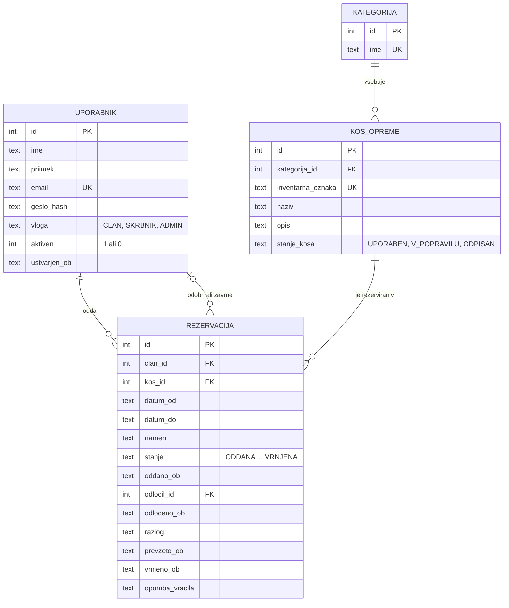

# 03 – Podatkovni model

Model je relacijski in je namenjen bazi SQLite. Ima štiri povezane entitete: **Uporabnik**, **Kategorija**, **Kos opreme** in **Rezervacija**. Podatki o prevzemu in vračilu so del rezervacije, ker ima vsaka rezervacija največ en prevzem in eno vračilo.

## Diagram

## Entitete in glavna polja

### Uporabnik

| Polje | Pomen |
|---|---|
| `id` | enolični ključ |
| `ime`, `priimek` | ime in priimek člana |
| `email` | e-naslov za prijavo, unikaten |
| `geslo_hash` | zgoščeno geslo (scrypt s soljo), nikoli geslo v čistem besedilu |
| `vloga` | `CLAN`, `SKRBNIK` ali `ADMIN` |
| `aktiven` | 1 = lahko se prijavi, 0 = deaktiviran |
| `ustvarjen_ob` | čas ustvarjanja računa |

### Kategorija

| Polje | Pomen |
|---|---|
| `id` | enolični ključ |
| `ime` | ime kategorije, unikatno (npr. Fotografija, Taborjenje, Ozvočenje in projekcija, Kolesa) |

### Kos opreme

| Polje | Pomen |
|---|---|
| `id` | enolični ključ |
| `kategorija_id` | tuji ključ na kategorijo |
| `inventarna_oznaka` | oznaka na nalepki, unikatna (npr. FOTO-02) |
| `naziv`, `opis` | kratko ime in neobvezen opis |
| `stanje_kosa` | `UPORABEN`, `V_POPRAVILU` ali `ODPISAN` |

### Rezervacija

| Polje | Pomen |
|---|---|
| `id` | enolični ključ |
| `clan_id` | tuji ključ na uporabnika, ki je rezervacijo oddal (lastnik) |
| `kos_id` | tuji ključ na kos opreme |
| `datum_od`, `datum_do` | termin, celi dnevi, oba vključena |
| `namen` | neobvezen kratek opis (npr. »izlet foto sekcije«) |
| `stanje` | `ODDANA`, `ODOBRENA`, `ZAVRNJENA`, `PREKLICANA`, `PREVZETA` ali `VRNJENA` |
| `oddano_ob` | čas oddaje; določa vrstni red v seznamu čakajočih |
| `odlocil_id`, `odloceno_ob` | skrbnik, ki je rezervacijo odobril ali zavrnil, in čas odločitve |
| `razlog` | razlog zavrnitve ali preklica (pri preklicu s strani skrbnika obvezen) |
| `prevzeto_ob` | čas evidentiranega prevzema |
| `vrnjeno_ob` | čas evidentiranega vračila |
| `opomba_vracila` | stanje kosa ob vračilu; obvezna, če je kos poškodovan |

Datumi in časi so shranjeni kot besedilo v obliki ISO 8601 (`2026-11-13`, `2026-11-13T17:05:00`).

## Povezave in kardinalnosti

| Povezava | Kardinalnost | Pomen |
|---|---|---|
| Kategorija – Kos opreme | 1 : 0..N | vsak kos je v natanko eni kategoriji |
| Kos opreme – Rezervacija | 1 : 0..N | rezervacija velja za natanko en kos (P4) |
| Uporabnik – Rezervacija (`clan_id`) | 1 : 0..N | rezervacijo odda natanko en uporabnik |
| Uporabnik – Rezervacija (`odlocil_id`) | 0..1 : 0..N | rezervacijo odobri ali zavrne največ en skrbnik |

## Pravila celovitosti

- `email`, `inventarna_oznaka` in ime kategorije so unikatni.
- `datum_od` ne sme biti po `datum_do` (omejitev `CHECK` v bazi).
- Prekrivanja terminov ni mogoče izraziti s preprosto omejitvijo v bazi. Preverja ga backend v isti transakciji, v kateri shrani rezervacijo (glej 04, ADR 0006).
- Brisanja ni tam, kjer bi izgubili zgodovino: kos se ne briše, ampak dobi stanje `ODPISAN`; uporabnik se ne briše, ampak se deaktivira; kategorije s kosi ni mogoče izbrisati.
- Zamuda se ne shranjuje posebej. Izračuna se iz `datum_do`, `vrnjeno_ob` in današnjega datuma.

## Usklajenost z vlogami in procesom

| Del procesa ali vloga | Podatki |
|---|---|
| Prijava in pravice (F01) | `Uporabnik.email`, `geslo_hash`, `vloga`, `aktiven` |
| Razpoložljivost (F02) | `Kos opreme.stanje_kosa` in aktivne rezervacije kosa (`stanje`, `datum_od`, `datum_do`) |
| Oddaja rezervacije (F03) | nova vrstica v Rezervaciji s stanjem `ODDANA` in `oddano_ob` |
| Odobritev ali zavrnitev (F04) | `stanje`, `odlocil_id`, `odloceno_ob`, `razlog` |
| Prevzem (F05) | `stanje` = `PREVZETA`, `prevzeto_ob` |
| Vračilo (F06) | `stanje` = `VRNJENA`, `vrnjeno_ob`, `opomba_vracila`, po potrebi `Kos opreme.stanje_kosa` = `V_POPRAVILU` |
| Preklic (F07) | `stanje` = `PREKLICANA`, `razlog` |
| Zamude in zgodovina (F11, F12) | rezervacije kosa s stanjem `PREVZETA` ali `VRNJENA` ter njihovi datumi |
| Upravljanje (F09, F10) | Kategorija, Kos opreme, Uporabnik |

Kdo je evidentiral prevzem, vračilo ali preklic, se v prvi različici ne hrani; zapisan je samo skrbnik, ki je rezervacijo odobril ali zavrnil.
