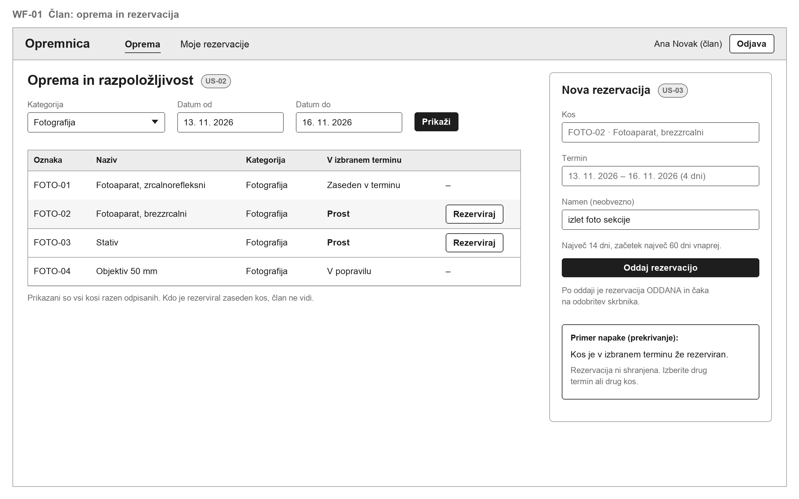
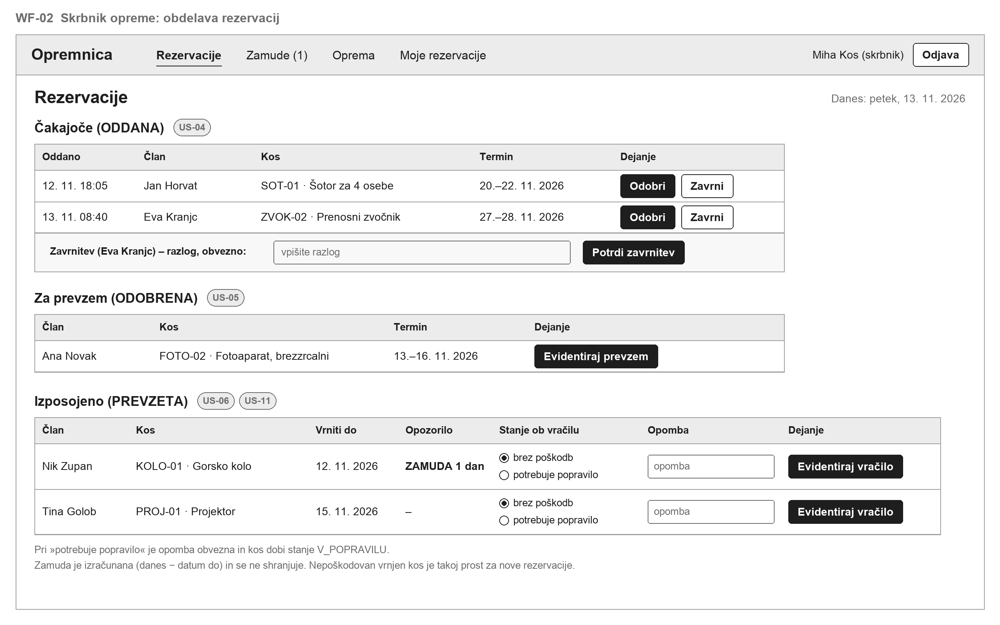
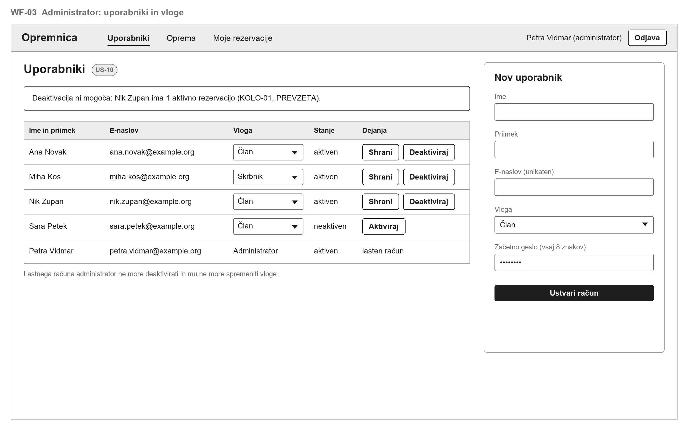

# 06 – Wireframes

Trije preprosti črno-beli wireframi prikazujejo osnovni izgled glavnih zaslonov za vsako vlogo. Niso končni dizajn. Oznake US na slikah kažejo, katero zgodbo iz [05-uporabniske-zgodbe.md](05-uporabniske-zgodbe.md) zaslon podpira. Podatki na slikah so izmišljeni primeri.

## WF-01 Član: oprema in rezervacija

Zaslon, ki ga član vidi po prijavi.

- Filter *Kategorija*, *Datum od*, *Datum do* in tabela kosov z razpoložljivostjo »Prost«, »Zaseden v terminu« ali »V popravilu« (US-02). Kdo je rezerviral zaseden kos, ni prikazano.
- Gumb *Rezerviraj* je samo pri prostih kosih (US-02).
- Obrazec *Nova rezervacija* z izbranim kosom, terminom, neobveznim namenom in pravili P2/P3 (US-03).
- Primer napake pri prekrivanju: rezervacija se ne shrani (US-03, pravilo R1).
- Povezava *Moje rezervacije* vodi na seznam lastnih rezervacij (US-07, US-08).

## WF-02 Skrbnik opreme: obdelava rezervacij

Začetni zaslon skrbnika, prikazan za petek, 13. 11. 2026.

- *Čakajoče (ODDANA)*: gumba *Odobri* in *Zavrni*; zavrnitev zahteva razlog (US-04).
- *Za prevzem (ODOBRENA)*: gumb *Evidentiraj prevzem* za Anino rezervacijo iz scenarija v 01 (US-05).
- *Izposojeno (PREVZETA)*: izbira stanja kosa ob vračilu, opomba in gumb *Evidentiraj vračilo* (US-06).
- Opozorilo »ZAMUDA 1 dan« je izračunano iz datuma do in današnjega dne; ne shranjuje se (US-06, US-11). Povezava *Zamude (1)* vodi na seznam zamujenih vračil.
- Po vračilu brez poškodb je kos takoj prost za nove rezervacije (P5).

## WF-03 Administrator: uporabniki in vloge

Začetni zaslon administratorja.

- Tabela uporabnikov z izbiro vloge, stanjem računa ter gumbi *Shrani*, *Deaktiviraj* in *Aktiviraj* (US-10).
- Sporočilo, da računa z aktivno rezervacijo ni mogoče deaktivirati (US-10, kriterij 3).
- Lastnega računa administrator ne more spremeniti (US-10, kriterij 4).
- Obrazec *Nov uporabnik* z obveznimi polji in začetnim geslom z vsaj 8 znaki (US-10, kriterij 1).

## Zgodbe brez lastnega wireframa

US-01 (prijava), US-07 (preklic), US-08 (moje rezervacije), US-09 (urejanje opreme) in US-12 (zgodovina kosa) uporabljajo enake gradnike: obrazec ali tabelo z gumbi. Zanje ločeni wireframi v tej fazi niso narejeni.
